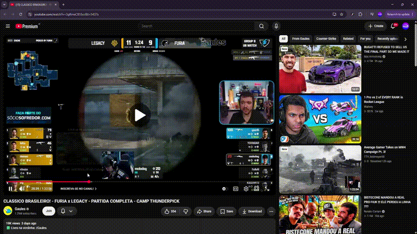
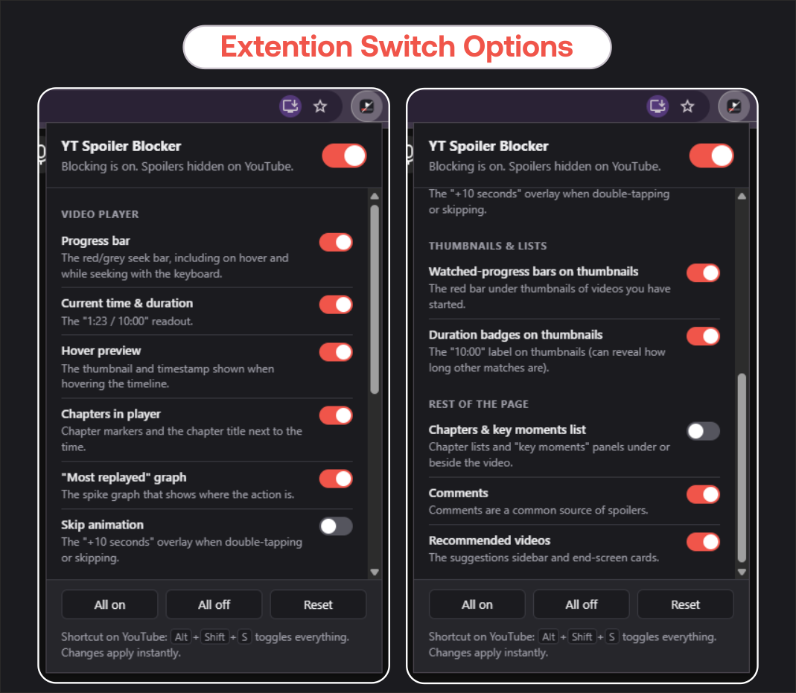
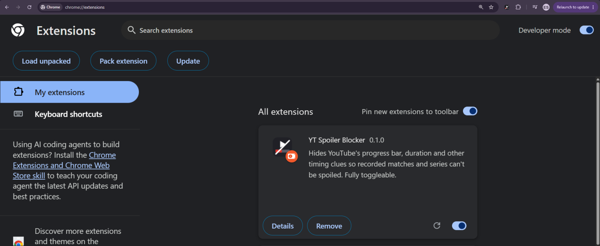

<h1 align="center">🙈 YT Spoiler Blocker</h1>

<p align="center">
  <b>Watch recorded matches and series without YouTube giving away the result.</b><br>
  Hide the progress bar, the video duration and every other timing clue, with one switch per spoiler.
</p>

<p align="center">
  
  
  
</p>

<p align="center">
  
</p>

<details>
<summary><b>▶ Watch the full demo video</b> (pause, rewind, sound)</summary>

https://github.com/user-attachments/assets/2475e95c-ddc2-49b7-9a51-9f02184bf63c

</details>

## The problem

You're watching a recorded best-of-3. Team A wins game 1. Then you look at the **video progress bar** at the bottom of the YouTube video: the total time next to it says **10:00**, and game 1 only took 5 minutes. Team A must have won 2-0, and the rest of the video is spoiled before you've watched it.

Progress bars, durations, hover thumbnails, chapter lists and "Most replayed" graphs all leak this kind of information. YT Spoiler Blocker hides them, and it keeps them hidden when you hover over the video, hover over the timeline, or press <kbd>M</kbd>, <kbd>C</kbd>, <kbd>K</kbd>, <kbd>Space</kbd> or the arrow keys.

## What it can hide

Every item below has its own switch, plus a master on/off switch at the top.

| Area | Toggles |
| --- | --- |
| 🎬 **Video player** | Progress bar · Current time & duration · Hover preview · Chapters in player · "Most replayed" graph · Skip animation |
| 🖼️ **Thumbnails & lists** | Watched-progress bars on thumbnails · Duration badges on thumbnails |
| 📄 **Rest of the page** | Chapters & key moments list · Comments · Recommended videos |

<p align="center">
  <a href="assets/imgs/extension-switch-options.png">
    
  </a>
</p>

- ⚡ **Instant**: changes apply right away, with no page reload.
- ⌨️ **Quick toggle**: press <kbd>Alt</kbd> + <kbd>Shift</kbd> + <kbd>S</kbd> on YouTube to turn everything on or off.
- 🔄 **Syncs between your devices** through your browser account once installed on each one.
- 🌗 **Light and dark popup**, following your system theme.
- 🔒 **Private**: no tracking, no network requests, no data collected. It only runs on YouTube pages.

## Supported devices

| Where | Status |
| --- | --- |
| 💻 **Desktop Chrome, Edge, Brave, Opera, Vivaldi** (Windows, macOS, Linux) | ✅ Supported |
| 🦊 Desktop Firefox | ⚠️ Not tested (needs a small manifest change) |
| 🧭 **Safari** (Mac, iPhone, iPad) | ❌ Not supported |
| 📱 **Phones and tablets** (Android, iPhone, iPad) | ❌ Not supported yet |

**Why not on mobile?** The YouTube app can't run extensions at all, and the regular Chrome app on Android doesn't let you install your own. The extension is also written for YouTube's desktop layout, and the mobile YouTube website (`m.youtube.com`) is built differently, so the hiding rules wouldn't match even if an extension could load. Phone support would need its own set of rules, which hasn't been built.

## Install (desktop)

It isn't on the Chrome Web Store, so you load it manually. It takes about a minute and works on any desktop or laptop.

1. **Get the files.** Click **Code → Download ZIP** at the top of this page and extract it, or run:
   ```bash
   git clone https://github.com/eversoneder/Yt-Spoiler-Blocker-Extension.git
   ```
2. **Open the extensions page.** Type `chrome://extensions` in the address bar (`edge://extensions` in Edge, `brave://extensions` in Brave).
3. **Turn on Developer mode** with the switch in the top-right corner.
4. **Click Load unpacked** and select the folder that contains `manifest.json`.
5. **Pin it** from the puzzle-piece menu in the toolbar so the popup is one click away.

<p align="center">
  <a href="assets/imgs/chrome-extension-url.png">
    
  </a>
</p>

**Updating:** download or `git pull` the new files, then click the reload ↻ icon on the extension's card.

## How it works

The extension doesn't touch YouTube's servers or video stream. A small script reads your saved settings and sets flags on the page. Plain CSS rules then hide the matching elements. Because hiding is done by CSS and not by reacting to events, YouTube can't bring an element back when you move the mouse or press a key, and nothing flashes while the page loads.

| File | Purpose |
| --- | --- |
| `manifest.json` | Extension definition (Manifest V3) |
| `options.js` | The list of toggles. It is the single source of truth for the popup and the content script |
| `content.js` | Applies the saved settings to the YouTube page as `data-ysb-*` attributes |
| `content.css` | The hiding rules, one block per toggle |
| `popup.html` / `popup.css` / `popup.js` | The settings popup, built from `options.js` |

## Something still showing?

YouTube renames its page elements from time to time, so a toggle can stop working. To fix it:

1. Right-click the element → **Inspect**, and note its class or tag name.
2. Add it to the matching block in `content.css`.
3. Reload the extension.

To add a brand-new toggle, add an entry in `options.js` and a matching `html[data-ysb-<key>]` block in `content.css`. The popup builds itself from the list. Issues and pull requests are welcome.

## Disclaimer

This is an independent project and isn't affiliated with, endorsed by, or sponsored by YouTube or Google. It only changes how pages look in your own browser.
